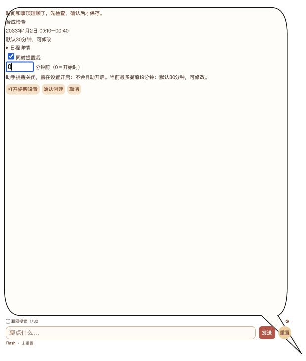
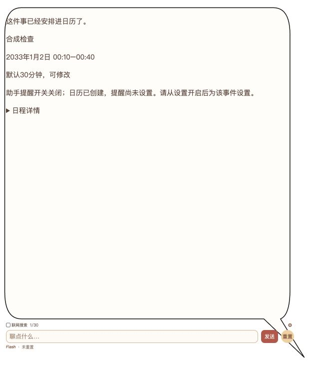
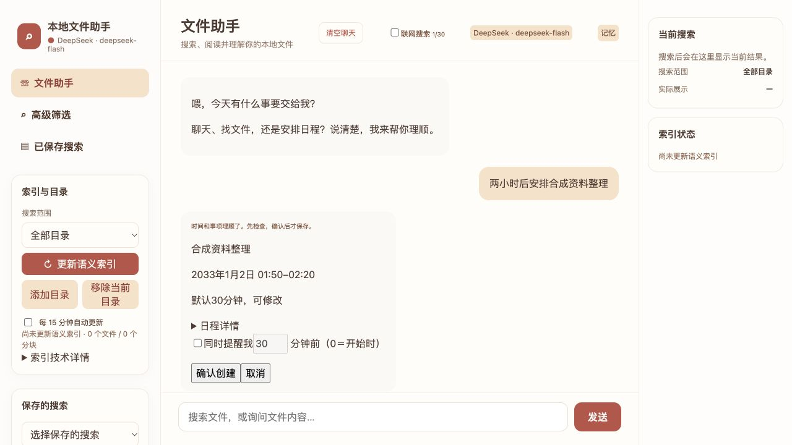

# 日历与助手提醒

只处理明确可支持的事件类型，可信身份、版本、冲突、预览确认及读回由代码执行。创建默认30分钟，修改保留时长；权限恢复不自动执行。助手提醒默认关闭，单次所选未来事件显式开启，不写系统alarm。睡眠、退出和补提醒限制见[README](../README.md)，真实修改/删除需核对具体对象后人工确认。

## 2026-10-23 相对时间与创建时设置提醒

相对开始时间由代码按消息抵达后端的可信时刻计算，保存原始表达、基准、目标及时区。普通补充、权限恢复及确认不重算；用户明确纠正才按新消息计时。澄清是回复状态，不删除未完成的创建任务；仅继承程序保存的待补字段，不猜事项、不继承失效确认。目标过期会明确拒绝，不自动顺延。创建默认30分钟，修改保留原时长。

预览主区保留简短表达、标题、易读日期/起止时间、必要默认时长、确认/取消。目标日历、时区、承载关系及原始回执在“日程详情”；未确认不宣称创建成功。

“同时提醒我”由用户选择；明确提醒请求可预选，普通创建不强加。默认提前30分钟，值失效时保留预览并要求修改，不改变开始时间。支持0分钟（开始时提醒），仅接受0–10080的整数分钟；前端每10秒刷新范围，后端确认及保存前再次校验。0分钟在正常轮询中最多容忍60秒投递迟滞，超过则过期；这不承诺睡眠/关机期间准时。

日历写入并读回成功后，才按同次确认的提醒选项读取核验真实事件并保存助手计划。总开关关闭不自动开启，可从现有设置启用；日历成功与提醒未设置/失败/未知分别回执。计划用原创建请求身份去重；保存结果未知先查持久化操作记录，不盲目重做。后端重启不恢复已失效的旧确认，可通过提醒列表核对已保存计划。不是EventKit alarm，不监控所有日历。

此前0e804ce真实多轮失败已保留：外层clarify曾覆盖提取层create/resume。当前修补通过整组真实DeepSeek＋隔离日历旅程，仍不等于私人EventKit写入或原生鼠标验收。

### 脱敏产品示例

以下为独立测试实例的真实浏览器截图，使用合成事项及2033年可控时钟。创建回执来自模拟日历，非私人日程；未公开建议DOCX原件和其中涉及个人事项的截图。

